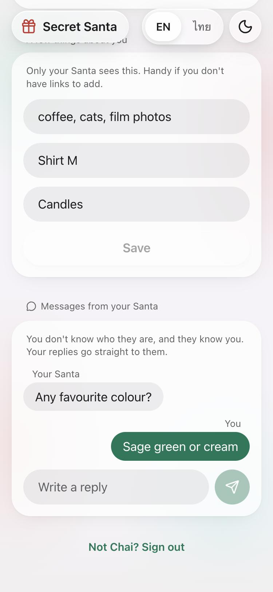
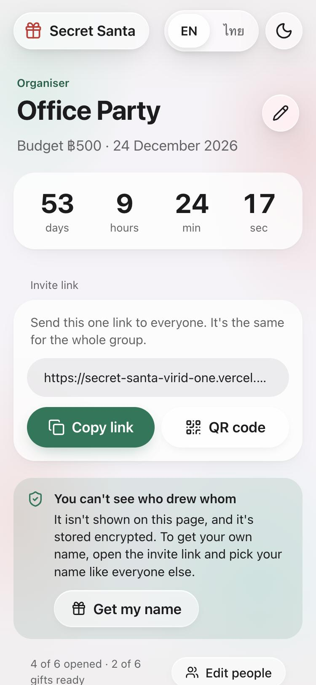

# Secret Santa

Draw names for a gift exchange and share one link. Everyone picks their own name, unwraps a gift to see who they drew, and nobody else can see the result, including the organiser. No accounts or apps needed, in Thai and English.

**Live:** https://secret-santa-virid-one.vercel.app

<p>
  
  
  
</p>
<p>
  
  
  
</p>

## Features

**Running the draw**
- **One invite link** for the whole group, with Copy, Share, Messenger (on phones) and a QR code.
- **Exclusions:** keep couples or housemates from drawing each other.
- **Budget, party date and a note** for everyone, with a live countdown.
- **Change the group later:** add or remove people and everyone gets a new name. Renaming someone keeps the draw.
- **See who's ready:** who has joined, opened their name and got their gift, without showing who it's for.
- **Copy a reminder:** a ready-made message for your group chat naming anyone still to open their name or get a gift.
- **Draw again:** the same group for next year, avoiding last round's matches when the group is big enough.
- **Delete the group:** removes every name, wish list and message.

**Taking part**
- **Pick your name and set a 4-digit PIN.** It opens your name on another phone, and tells you if someone else has already taken your name.
- **Unwrap a gift** to see who you drew, with falling snow and confetti. It wraps itself again on each visit, so the name is never on screen by surprise.
- **Wish lists:** paste a link from Shopee, Lazada or TikTok Shop. The site recognises the shop and fills in the product name when the link includes one.
- **A few things about you:** likes, sizes and "please no", for people without links to add.
- **Gift search:** search the three shops, starting from what your person likes.
- **Anonymous messages:** ask your person a question. They see "Your Santa" and can reply without learning who asked.

**Everywhere**
- Thai and English, picked from your phone's language, with a switch at the top.
- Light and dark themes, and reduced motion is respected.
- Frosted-glass design shared with [Bill Splitter](https://github.com/IsaraApae/billsplitter-th).

## How the secret is kept

- Each person's result is encrypted (AES-256-GCM) before it reaches the database, and is bound to that person and group.
- The server only returns a result to the person who drew it, after their PIN. The organiser's page never receives results.
- Anonymous messages are stored under the person receiving the gift, so nothing stored names their Santa.
- PINs are hashed with scrypt and lock for an hour after repeated wrong tries.

**What it can't prevent:**
- An organiser could reset someone's PIN and log in as them. The reset then shows on the group page for everyone.
- Someone holding both the database and `SEAL_SECRET` could decrypt the results on purpose.
- With exactly 3 people, your own result reveals the whole circle, so the site warns about it.

## Run it locally

```bash
npm install
npm run dev
```

Open http://localhost:3000. No setup is needed: data lives in memory until the server stops.

```bash
npm test                                      # draw, encryption and shop-link tests
node scripts/smoke.mjs http://localhost:3000  # full check against a running site
```

## Deploy your own

1. Import this repository into [Vercel](https://vercel.com).
2. Connect a Redis database from Storage → Marketplace. This sets `REDIS_URL`, or `KV_REST_API_URL` and `KV_REST_API_TOKEN` for Upstash.
3. Add `SEAL_SECRET` for Production, set to the output of `openssl rand -base64 32`.

> [!WARNING]
> Never change `SEAL_SECRET` after people have drawn names. Every existing draw becomes unreadable.

Groups expire 180 days after their last change.

## Built with

Next.js, React, Tailwind CSS, Redis and Zod.
