# Secret Santa

Run a gift exchange from one link. Create a group, share the link, and everyone adds themselves. When everyone's in, draw names, and each person unwraps a gift to see who they drew. No accounts or apps needed.

**Live:** https://secretsanta-draw.vercel.app

<p>
  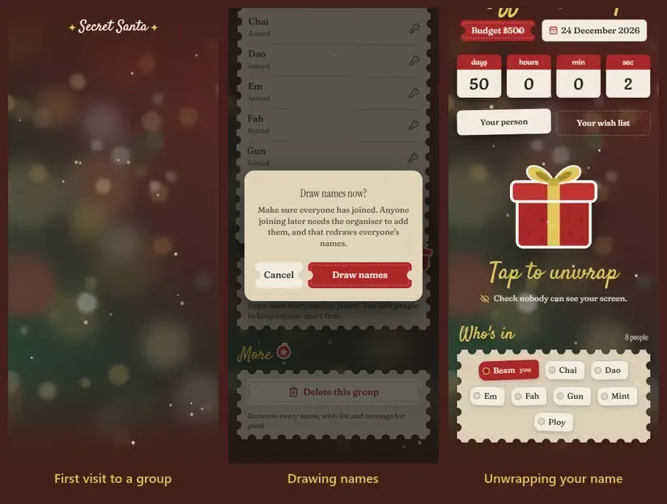
  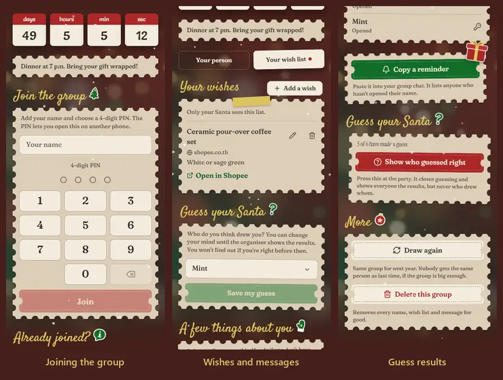
</p>
<p>
  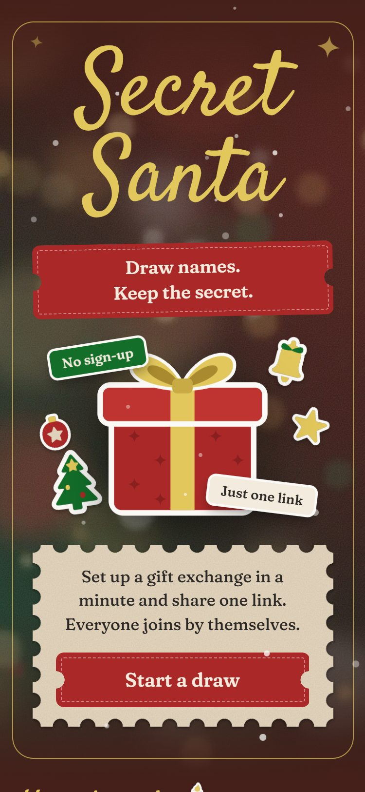
  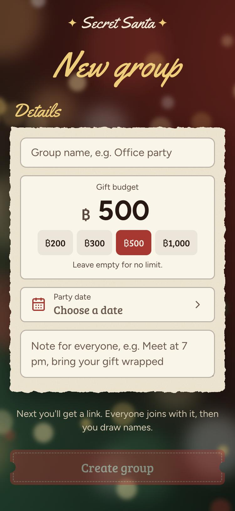
  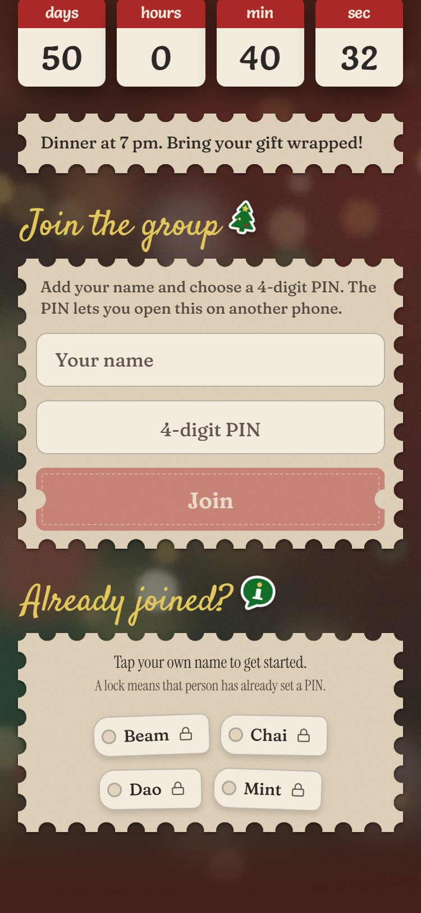
</p>
<p>
  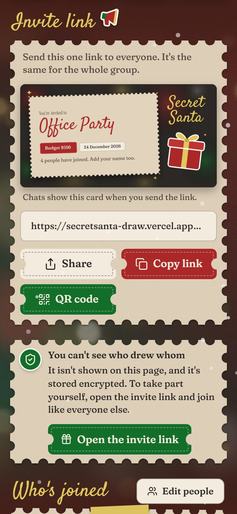
  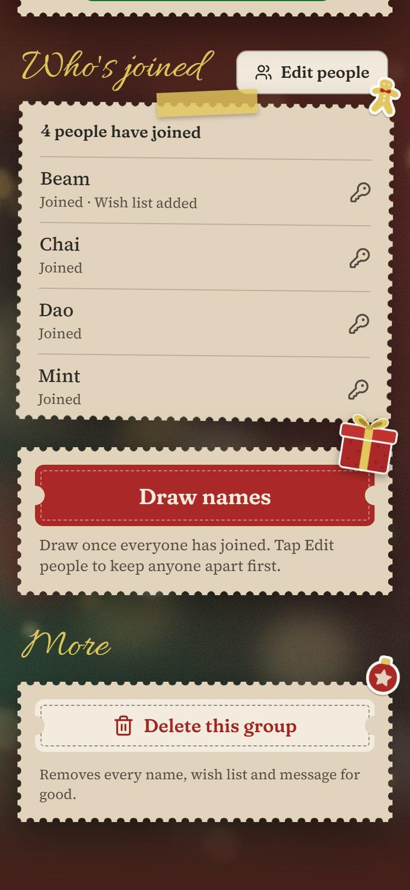
  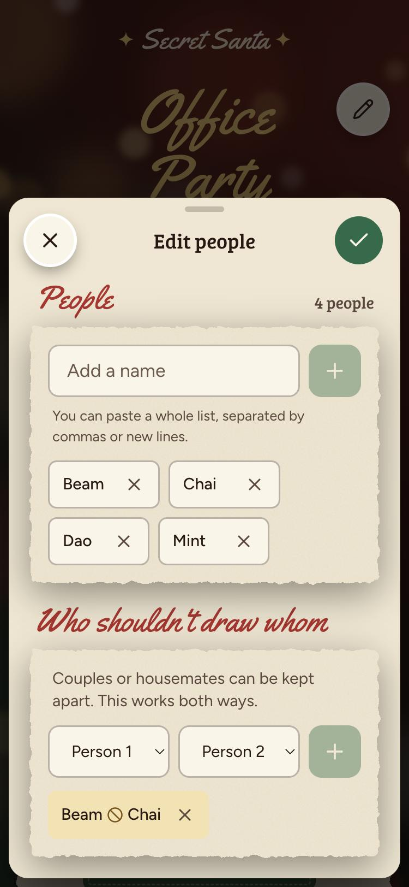
</p>
<p>
  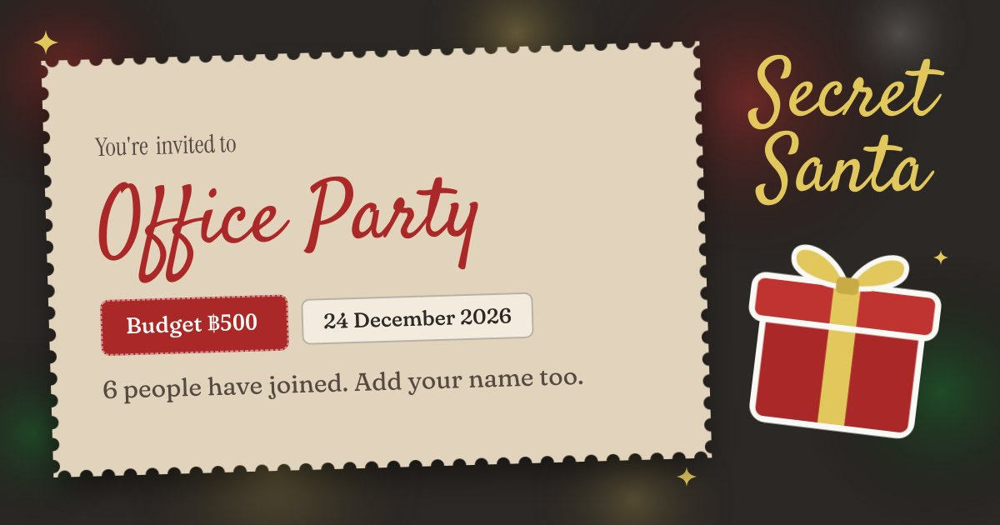
</p>
<p>
  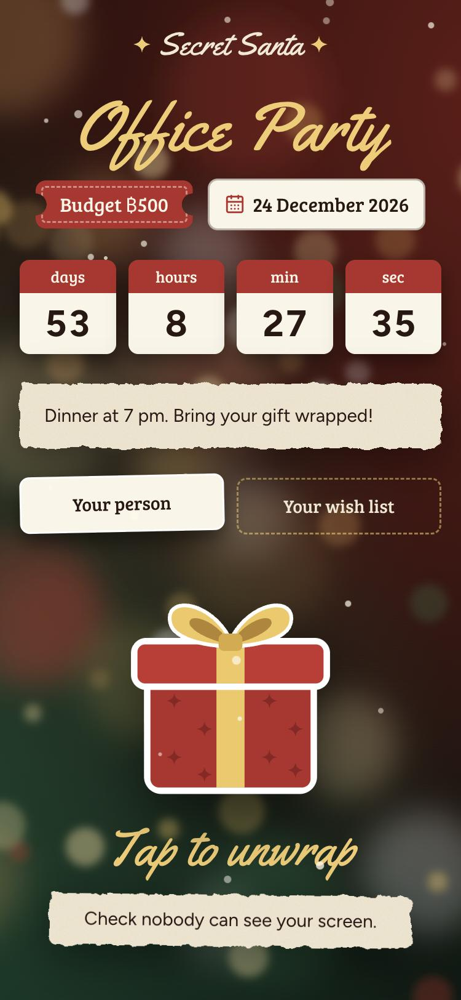
  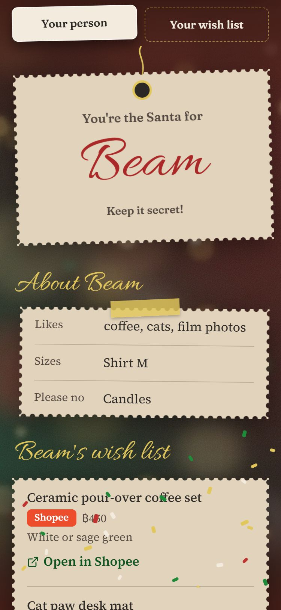
  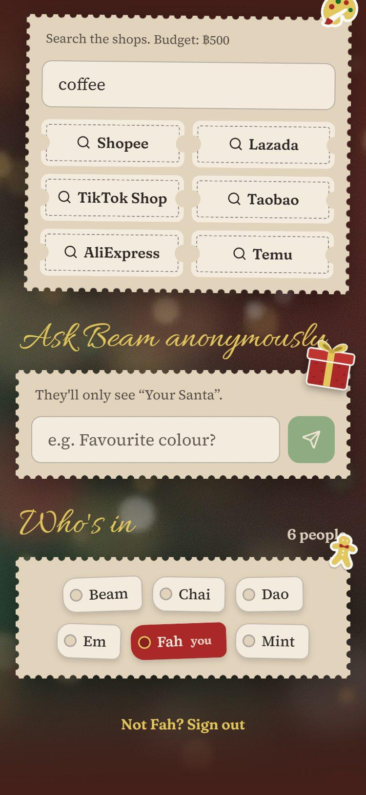
</p>
<p>
  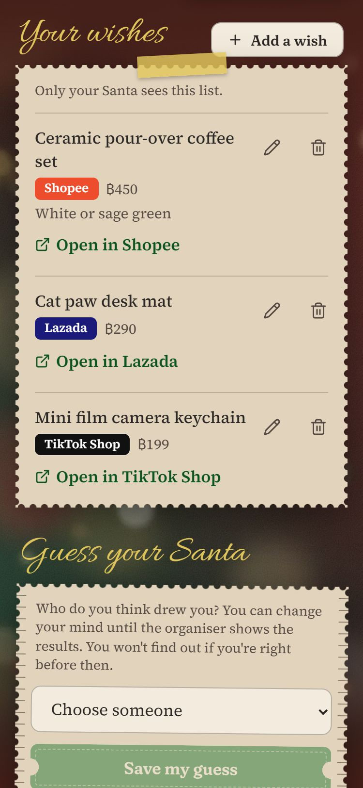
  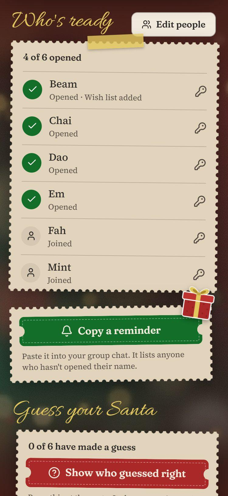
  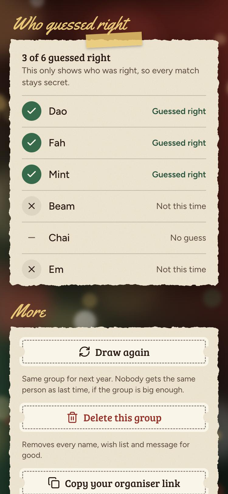
</p>

The screenshots use a demo group with made-up names.

## Features

**Running the draw**
- **One invite link** for the whole group, with Copy, Share (on phones) and a QR code. You never type a list of names.
- **An invite card:** send the link in LINE, Messenger or WhatsApp and it shows a card with the group name, budget, date and how many have joined.
- **Draw when you're ready:** see who has joined, then draw once at least 3 people are in.
- **Exclusions:** keep couples or housemates from drawing each other. Pairs you've already kept apart are grayed out in the pickers.
- **Budget, party date and a note** for everyone: a big budget field with shortcuts, the site's own calendar, and a live countdown.
- **Change the group later:** add or remove people and everyone gets a new name. Renaming someone keeps the draw.
- **See who's ready:** who has joined and who has opened their name, updating by itself every few seconds.
- **Copy a reminder:** a ready-made message for your group chat naming anyone still to open their name.
- **Draw again:** the same group for next year, avoiding last round's matches when the group is big enough.
- **Delete the group:** removes every name, wish list and message.
- **Only the organiser manages it:** the organiser page works only on the phone that made the group. The server ties the group's key to that phone, so even a key copied from an old organiser link is refused anywhere else.
- **Drawing is a show:** everyone's name tag flies into the present, which shakes and bursts into confetti.

**Taking part**
- **Join with your name and a 4-digit PIN,** tapped on the site's own keypad. The PIN opens your page on another phone.
- **Change your name** any time, before or after the draw, to fix a typo or use a nickname. Everyone sees the new one, your Santa too; your PIN, wish list and messages stay.
- **See who's in:** once you've joined, your page lists everyone in the group by name, with yours marked. Never who drew whom. Your tag drops in when you join, and so does anyone else's who joins while you're there.
- **The first time you open a group,** its page lays itself out: the name writes itself in, the tickets drop and the cards rise.
- **Unwrap a gift** to see who you drew: confetti bursts and the name writes itself onto a gift tag. It wraps itself again on each visit, so the name is never on screen by surprise.
- **Wish lists:** paste a link from any shop. The site recognises Shopee, Lazada, TikTok Shop, Taobao, Tmall, JD, AliExpress, Temu, SHEIN, Amazon, eBay and Etsy, and fills in the product name when the link includes one. Every link shows the website it really goes to, so a link can't pass for a shop it isn't. A saved wish drops onto your list with a tick, like a name tag joining.
- **Real prices:** there's no price box, so nobody can list an expensive gift as cheap. For shops that let price checkers in, like IKEA, Central and B2S, the site reads the price from the shop's own page, shows it as "฿39 at ikea.com", and checks it again every six hours. It says who it is when it asks, and many big shops turn away automated visitors from cloud servers (Shopee, Lazada, JIB, Banana, Power Buy, Watsons, Uniqlo, Amazon and Etsy among them), so their links show the website but no price.
- **A few things about you:** likes, sizes and "please no", for people without links to add.
- **Gift search:** search Shopee, Lazada, TikTok, Taobao, AliExpress and Temu, starting from what your person likes.
- **Anonymous messages:** ask your person a question. They see "Your Santa" and can reply without learning who asked. A message you send flies off as an envelope.
- **Guess your Santa:** pick who you think drew you, and change your mind until the organiser shows the results. The table shows only who was right, not who they named, and the first time you see it each row flips over like a card.

**Everywhere**
- An English interface. Names and wishes people type can be in Thai too, with matching Thai fonts.
- The Cultural Fest 2027 look: grainy blurred lights, gold script, stamp-edged cream cards, punched tickets and the CI's own die-cut stickers, recorded in [DESIGN.md](DESIGN.md).
- Fast on phones: about 290 KB for the home page, and only the font weights and axes the site uses. An open page checks for changes with one request every few seconds, and stops while it's in the background. The animations move only position and transparency, so phones and LINE's browser play them without redrawing the page.
- Reduced motion is respected.

## How the secret is kept

- Each person's result is encrypted (AES-256-GCM) before it reaches the database, and is bound to that person and group.
- The server only returns a result to the person who drew it, after their PIN. The organiser's page never receives results.
- Anonymous messages are stored under the person receiving the gift, so nothing stored names their Santa.
- Guesses get no feedback before the reveal, so guessing can't be used to find your Santa.
- PINs are hashed with scrypt and lock for an hour after repeated wrong tries.

**What it can't prevent:**
- Anyone with the link can join before the draw, so organisers should check the list and remove anyone unexpected.
- An organiser could reset someone's PIN and log in as them. The reset then shows on the group page for everyone.
- Someone holding both the database and `SEAL_SECRET` could decrypt the results on purpose.
- With exactly 3 people, your own result reveals the whole circle, so the site warns about it when people are added by hand.

## Run it locally

```bash
npm install
npm run dev
```

Open http://localhost:3000. No setup is needed: data lives in memory until the server stops.

```bash
npm test                                      # draw, encryption and shop-link tests
node scripts/smoke.mjs http://localhost:3000  # full check against a running site
```

## Deploy your own

1. Import this repository into [Vercel](https://vercel.com).
2. Connect a Redis database from Storage → Marketplace. This sets `REDIS_URL`, or `KV_REST_API_URL` and `KV_REST_API_TOKEN` for Upstash.
3. Add `SEAL_SECRET` for Production, set to the output of `openssl rand -base64 32`.

> [!WARNING]
> Never change `SEAL_SECRET` after people have drawn names. Every existing draw becomes unreadable.

Groups expire 180 days after their last change.

## Built with

Next.js, React, Tailwind CSS, Redis and Zod.
